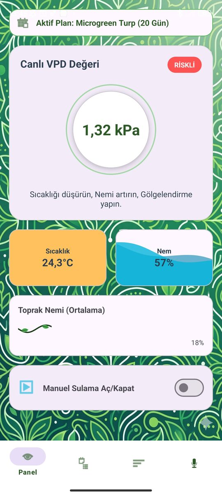
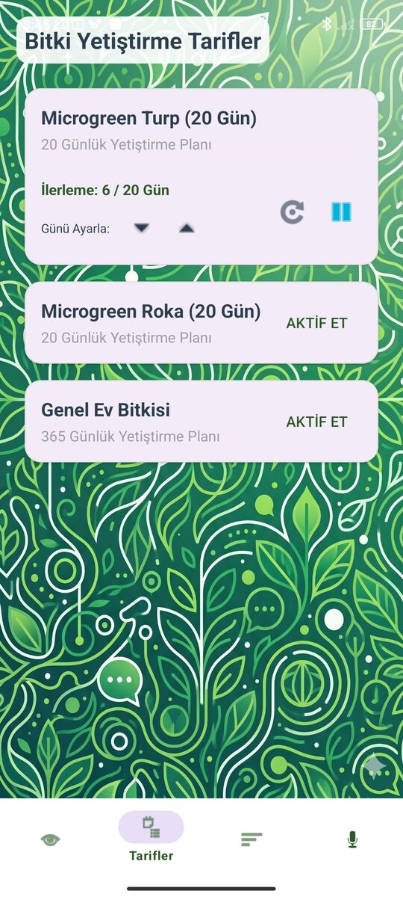
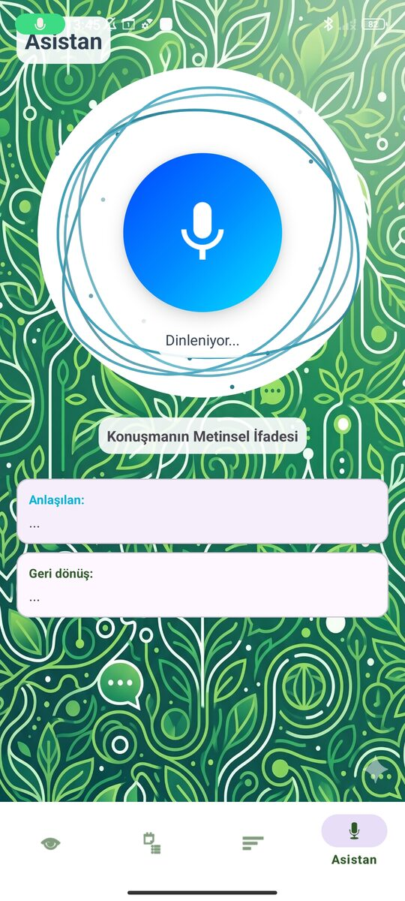
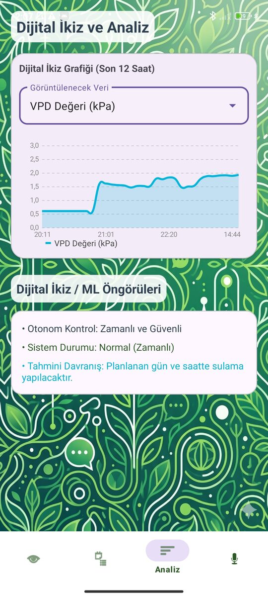
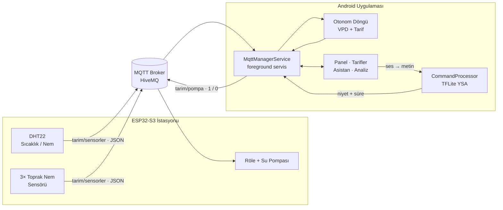
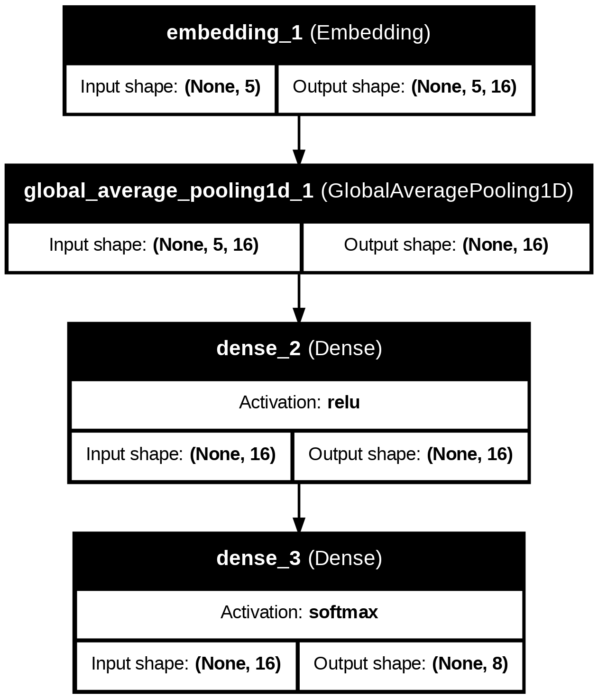
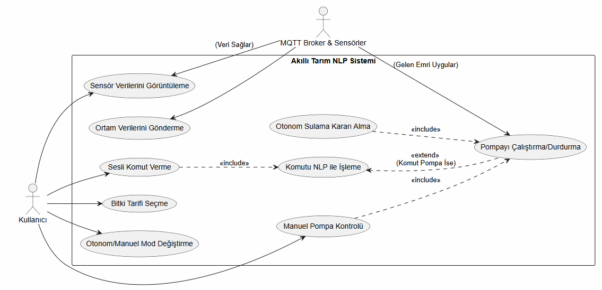

<h1 align="center">🌱 Akıllı Tarım Asistanı</h1>

<p align="center">
  ESP32 sensör istasyonu, bitkiye özel VPD tabanlı otonom sulama ve<br>
  <b>cihaz üzerinde çalışan bir yapay sinir ağıyla</b> sesli komut anlayan Android uygulaması.
</p>

<p align="center">
  
  
  
  
  
</p>

<p align="center">
  
  
  
  
</p>

---

## İçindekiler

- [Proje Hakkında](#proje-hakkında)
- [Özellikler](#özellikler)
- [Sistem Mimarisi](#sistem-mimarisi)
- [Sesli Komut Hattı (NLP)](#sesli-komut-hattı-nlp)
- [Makine Öğrenmesi Deneyleri](#makine-öğrenmesi-deneyleri)
- [VPD ve Otonom Sulama](#vpd-ve-otonom-sulama)
- [Donanım](#donanım)
- [Proje Yapısı](#proje-yapısı)
- [Kurulum](#kurulum)
- [Dokümanlar](#dokümanlar)
- [Bilinen Kısıtlar ve Yol Haritası](#bilinen-kısıtlar-ve-yol-haritası)

---

## Proje Hakkında

Sulama otomasyonları genellikle yalnızca toprak nemine bakar. Oysa bitkinin terlemesi ve besin alımı, sıcaklık ile bağıl nemin birlikte belirlediği **Buhar Basıncı Açığı (VPD)** değerine bağlıdır. Endüstriyel sera kontrol sistemleri bunu yapabilir ama küçük üreticiler için pahalıdır.

Akıllı Tarım Asistanı bu boşluğu **düşük maliyetli bir donanım ve bir Android uygulamasıyla** doldurmayı hedefler:

- ESP32 tabanlı istasyon sıcaklık, nem ve toprak nemini ölçer ve MQTT üzerinden yayınlar.
- Uygulama VPD'yi anlık hesaplar ve seçilen **bitki tarifinin** o günkü evresine göre pompayı otonom yönetir.
- Kullanıcı sistemi dokunarak ya da **Türkçe sesli komutla** yönetebilir. Komutlar internet gerektirmeden, telefondaki küçük bir yapay sinir ağıyla (TFLite, ~19 KB) anlaşılır.

Proje, Kastamonu Üniversitesi Bilgisayar Mühendisliği **Proje I** dersi kapsamında geliştirildi ve **Bilgisayar Mühendisliği Proje Şenliği**'nde sergilendi.

## Özellikler

| Modül | Açıklama |
|---|---|
| 📊 **Canlı Panel** | Anlık VPD (kPa), sıcaklık, nem ve ortalama toprak nemi; VPD riskli olduğunda öneri gösterir (ör. *"Sıcaklığı düşürün, nemi artırın"*) |
| 🌿 **Yetiştirme Tarifleri** | Microgreen Turp (20 gün), Microgreen Roka (20 gün), Genel Ev Bitkisi (365 gün). Her tarifin evrelere göre değişen hedef VPD aralıkları var |
| 🤖 **Otonom Mod** | Tarifteki hedeflere göre zamanlanmış darbe sulama ve acil durum sulaması; manuel moda tek dokunuşla geçiş |
| 🎙️ **Sesli Asistan** | Türkçe konuşma → metin → niyet sınıflandırma (TFLite) → MQTT komutu + sesli (TTS) geri bildirim |
| 📈 **Dijital İkiz ve Analiz** | Son 12 saatin VPD, nem, sıcaklık ve toprak verileri grafikte (MPAndroidChart); sistemin gece ne yaptığı görülebilir |
| 🔔 **Arka Plan Servisi** | MQTT bağlantısı ve otonom döngü, uygulama kapalıyken de çalışan bir foreground servisinde |

## Sistem Mimarisi



## Sesli Komut Hattı (NLP)

```
🎤 Ses ─► Android STT ─► Ön işleme ─► Tokenizasyon (5 token) ─► TFLite YSA ─► Niyet + Süre
                                                                     │
                                         güven < %65 ─► "Üzgünüm, bunu tam anlayamadım"
                                         güven ≥ %65 ─► MQTT komutu + TTS geri bildirimi
```

Model, cümleden **niyeti (intent)** çıkarır. Gerekirse süreyi de çıkarır: *"pompayı iki dakika çalıştır"* → `PUMP_ON, 120 sn`. Süre dolduğunda uygulama pompayı kendisi kapatır. Güven skoru %65'in altındaysa donanıma hiçbir komut gönderilmez.

| Niyet | Örnek komut |
|---|---|
| `PUMP_ON` | "pompayı aç", "bitkileri sula", "motoru çalıştırır mısın" |
| `PUMP_OFF` | "suyu kapat", "sulamayı kes", "pompayı durdur" |
| `QUERY_STATUS` | "sistemi kontrol et", "durum raporu ver", "sera ne alemde" |
| `QUERY_TEMP` | "sıcaklık kaç derece", "içerisi sıcak mı" |
| `QUERY_MOISTURE` | "nem nasıl", "toprak kuru mu" |
| `SET_AUTO_MODE` | "otonom moda geç", "otomatik sulamayı başlat" |
| `SET_MANUAL_MODE` | "manuel moda geç", "sistemi bana bırak" |
| `SET_RECIPE` | "turp tarifine geç", "ev bitkisi seç" |

## Makine Öğrenmesi Deneyleri

### 1. Konuşmadan metne (STT) model karşılaştırması

60 komutluk genişletilmiş Türkçe tarım komut seti üzerinde. Tüm modellerin ham çıktıları aynı Android ön işleme filtresinden geçirildi.

| STT Modeli | WER ↓ | Doğruluk ↑ |
|---|---:|---:|
| Google STT (on-device) | %10,76 | %89,24 |
| OpenAI Whisper Tiny | %31,01 | %68,99 |
| OpenAI Whisper Base | %16,46 | %83,54 |
| OpenAI Whisper Small | %10,13 | %89,87 |
| **OpenAI Whisper Medium** | **%5,06** | **%94,94** |
| Meta Wav2Vec2 (MMS-1B) | %8,86 | %91,14 |

<!-- TODO: Uygulamada neden Google STT seçildiğini 1-2 cümleyle yaz (ör. cihaz üzerinde çalışması, gecikme, model boyutu). -->

### 2. Niyet sınıflandırma: Doğrusal SVM ve Yapay Sinir Ağı

| Model | Accuracy | Macro F1 | Not |
|---|---:|---:|---|
| Doğrusal SVM | 0,73 | 0,76 | Emin olamadığı cümleleri `SET_RECIPE` sınıfına yığıyor (precision 0,16) |
| **YSA (TFLite)** | **1,00** | **1,00** | 3.944 parametre, ~19 KB, tamamen cihaz üzerinde |

<p align="center">
  
</p>

**Model mimarisi:** `Embedding(221 → 16)` → `GlobalAveragePooling1D` → `Dense(16, ReLU)` → `Dense(8, Softmax)`
<details>
<summary>Mimari görseli</summary>
<p align="center"></p>
</details>

**Denenip vazgeçilenler:** SVM'in hatalarını azaltmak için `hinge` yerine `squared_hinge` kaybı, `C` parametresi ayarı ve kelime tabanlı temsil yerine **TF-IDF n-gram** denendi. Sonuçlar kötüleştiği için bu değişiklikler geri alındı ve YSA yaklaşımına geçildi. SVM sürümü `experiment/svm` dalında saklanıyor.

> ⚠️ **Not:** Değerlendirme 60 cümlelik küçük bir test setiyle yapıldı. %100 sonuç, bu komut kümesi için umut verici olsa da genellenebilirlik açısından sınırlıdır. Eğitimde hiç görülmemiş, daha büyük bir test setiyle değerlendirme yol haritasında yer alıyor.
<!-- TODO: Notebook'u kontrol et. Test cümleleri eğitimde hiç kullanılmadıysa bu notu "eğitimde görülmemiş 60 cümle" diye güncelle. -->

Ham sonuçlar: [`ml/sonuclar/`](ml/sonuclar) · Eğitim notebook'ları: [`ml/notebooks/`](ml/notebooks)

## VPD ve Otonom Sulama

VPD, havanın bitkiden ne kadar nem "çektiğini" gösterir. Çok düşükse bitki terleyemez ve mantar riski artar; çok yüksekse bitki strese girer.

```
SVP = 0,6108 · e^(17,27·T / (T + 237,3))      [kPa]   (T: °C)
VPD = SVP · (1 − RH / 100)                     [kPa]   (RH: % bağıl nem)
```
<!-- TODO: Bu formülün koddaki hesaplamayla aynı olduğunu kontrol et. -->

Otonom döngü (`MqttManagerService`) her sensör paketinde:

1. JSON'u ayrıştırır, VPD'yi hesaplar ve arayüze iletir.
2. Toprak nemi **%10'un altına** inmişse acil sulama yapar.
3. Aktif tarifin o günkü evresine göre program zamanı geldiyse, tarifte belirtilen süre kadar **darbe sulama** (`performPulseIrrigation`) yapar.
4. Yapılan sulamayı cihaz hafızasına kaydeder; böylece aynı gün içinde mükerrer sulama olmaz.

Donanımı korumak için kontrol döngüsü dakikada en az 1, en fazla 60 kez tetiklenir.

## Donanım

| Bileşen | Görev |
|---|---|
| ESP32-S3 | Ana kontrolcü, Wi-Fi + MQTT istemcisi |
| DHT22 | Ortam sıcaklığı ve bağıl nem |
| 3× Toprak nem sensörü | Viyol/saksı bazında toprak nemi |
| Röle modülü + su pompası | Sulama |

| MQTT Kanalı | Yön | İçerik |
|---|---|---|
| `tarim/sensorler` | ESP32 → Uygulama | Sıcaklık, nem, toprak 1-2-3 (JSON) |
| `tarim/pompa` | Uygulama → ESP32 | `1` aç / `0` kapat |

<!-- TODO: Gerçek JSON örneğini ekle, ör. {"sicaklik": 24.3, "nem": 57, "toprak1": 18, ...} -->
<!-- TODO: Devre şeması veya kurulumun fotoğrafı varsa docs/images/ altına ekleyip burada göster. -->

## Proje Yapısı

```
akilli-tarim-asistani/
├── android/                 # Android Studio projesi (Java)
│   └── app/src/main/
│       ├── java/.../akillitarimnlp/
│       │   ├── nlp/CommandProcessor.java       # TFLite niyet sınıflandırma
│       │   ├── services/MqttManagerService.java # MQTT + otonom döngü
│       │   ├── models/                          # Tarif modelleri
│       │   └── *Fragment.java                   # Panel, Tarifler, Asistan, Analiz
│       └── assets/model.tflite                  # Eğitilmiş YSA modeli
├── firmware/                # ESP32 kodu
├── ml/
│   ├── notebooks/           # Model eğitimi, SVM, STT karşılaştırması
│   └── sonuclar/            # Sınıflandırma raporları, benchmark çıktıları
└── docs/
    ├── images/              # Ekran görüntüleri, grafikler, poster
    └── rapor/               # Proje I raporu (use case, diyagramlar)
```

## Kurulum

### Android uygulaması

1. Android Studio ile `android/` klasörünü açın (minSdk 24, targetSdk 36, Java 11).
2. MQTT broker bilgilerini ayarlayın.
   <!-- TODO: Broker adresi/kullanıcı bilgisi nereden okunuyor? (ör. local.properties → BuildConfig) -->
3. Uygulamayı cihaza yükleyin ve mikrofon izni verin.

### ESP32

<!-- TODO: Arduino IDE / PlatformIO, gerekli kütüphaneler, Wi-Fi ve MQTT ayarları -->
Ayrıntılar için [`firmware/`](firmware) klasörüne bakın.

## Dokümanlar

- 📄 [Proje I Raporu](docs/rapor/Proje1_Akilli_Tarim_Asistani_Raporu.pdf): alan tanımı, kabul ve kısıtlar, risk tablosu, use case, sözleşmeler, sınıf, sıralama ve etkileşim diyagramları
- 🖼️ [Proje Şenliği Posteri](docs/images/poster.jpg)

<details>
<summary>Use case diyagramı</summary>
<p align="center"></p>
</details>

## Bilinen Kısıtlar ve Yol Haritası

- [ ] Daha büyük ve eğitimden bağımsız bir test setiyle NLP değerlendirmesi
- [ ] `TFLiteTest` birim testini, native kütüphane gerektirmeyecek şekilde enstrümantasyon testine taşımak
- [ ] MQTT komutları için TLS ve kimlik doğrulama
- [ ] İnternet kesildiğinde ESP32 tarafında çevrimdışı otonom mod
- [ ] Yeni bitki tarifleri

## Geliştirici

**Samet Kapan**, Kastamonu Üniversitesi Bilgisayar Mühendisliği
<!-- TODO: LinkedIn / e-posta / portföy linki -->

## Lisans

Bu proje [MIT Lisansı](LICENSE) ile lisanslanmıştır.
